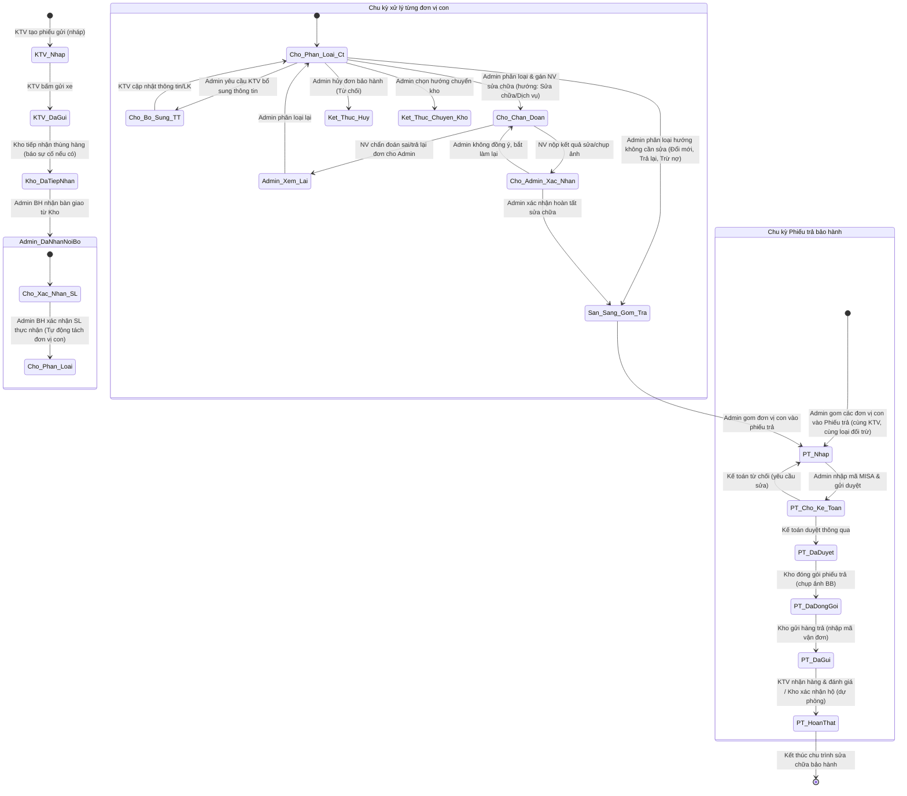

# Cải tiến Giao diện Hệ thống Quản lý Sửa chữa Bảo hành (QLBH 3T)

Dự án này là module mới **"Sửa chữa bảo hành"** để quản lý luồng gửi linh kiện/máy lỗi từ Kỹ thuật viên (KTV)/Cộng tác viên (CTV) về kho trung tâm sửa chữa và trả lại. 

Tài liệu này đề xuất các cải tiến UI/UX chi tiết cho toàn bộ các vai trò (KTV, Kho, Admin BH, NV Sửa chữa, Kế toán), chuyển các danh sách dạng thẻ (cards) sang dạng bảng (tables) tinh tế hỗ trợ Quick Action và Bulk Action, tối ưu hóa tốc độ tải dữ liệu lớn bằng cách giới hạn thời gian (lọc tuần/tháng) và thiết kế giao diện mobile-first tối ưu cho KTV.

---

## Phân tích Chi tiết Vai trò & Phân luồng Nghiệp vụ

Hệ thống có **5 vai trò chính**, mỗi vai trò có các chức năng công việc riêng biệt và quy trình khép kín:

### 1. Kỹ thuật viên / Cộng tác viên / Trạm (KTV)
*   **Thiết bị ưu tiên**: Mobile (Điện thoại thông minh/PWA chạy ngoài hiện trường).
*   **Chức năng chính**:
    *   Tạo phiếu gửi linh kiện lỗi về trung tâm (bắt buộc liên kết mã `case_id` có sẵn từ CRM).
    *   Lưu lịch sử gửi hàng (tự điền thông tin nhà xe/đơn vị vận chuyển của lần gửi gần nhất).
    *   Xác nhận đã gửi xe (chuyển trạng thái phiếu gửi từ `nhap` -> `da_gui`).
    *   Theo dõi tiến độ sửa chữa/thay đổi linh kiện thời gian thực.
    *   Bổ sung thông tin nếu Admin BH yêu cầu (sửa mô tả lỗi, thay đổi linh kiện gửi sai mã).
    *   Xác nhận đã nhận hàng trả từ trung tâm gửi về (+ Đánh giá chất lượng dịch vụ hoặc Mở khiếu nại vận chuyển nếu có sự cố thất lạc/hư hỏng).
*   **Nhắc nhở giao diện (3s-5s đầu tiên)**:
    *   Số lượng phiếu nháp chưa gửi đi.
    *   Số lượng đơn bị Admin yêu cầu bổ sung thông tin (Màu Đỏ/Khẩn cấp).
    *   Số lượng kiện hàng trả đang trên đường về cần xác nhận khi nhận được.

### 2. Nhân viên tiếp nhận Kho (Kho)
*   **Thiết bị ưu tiên**: Web (Máy tính bảng/Laptop tại kho trung tâm).
*   **Chức năng chính**:
    *   Tiếp nhận thùng hàng gửi từ KTV (quét mã QR dán trên thùng hàng hoặc tìm kiếm mã phiếu gửi).
    *   Ghi nhận sự cố tiếp nhận thùng hàng (móp méo, thiếu gói, hư hỏng vật lý trên đường vận chuyển - ghi log chung).
    *   Xác nhận tiếp nhận thùng hàng vật lý (chuyển trạng thái -> `da_tiep_nhan`).
    *   Đóng gói phiếu trả bảo hành sau khi được kế toán duyệt (chụp ảnh biên bản đóng gói).
    *   Xác nhận gửi hàng trả về cho KTV (nhập mã vận đơn/nhà xe).
    *   Xác nhận đóng đơn thay thế (dự phòng cho khách lẻ không có tài khoản tự xác nhận).
*   **Nhắc nhở giao diện (3s-5s đầu tiên)**:
    *   Số lượng thùng hàng đang trên đường tới chờ tiếp nhận (Màu Đỏ).
    *   Số lượng phiếu trả bảo hành đã được kế toán duyệt đang chờ đóng gói (Màu Đỏ).
    *   Số lượng phiếu đã đóng gói xong chờ xe/đơn vị vận chuyển qua lấy để gửi đi.

### 3. Admin bảo hành (Admin BH)
*   **Thiết bị ưu tiên**: Web (PC/Màn hình lớn để xử lý lượng đơn lớn).
*   **Chức năng chính**:
    *   Xác nhận tiếp nhận nội bộ thùng hàng bàn giao từ Kho (Mở thùng để bắt đầu kiểm đếm).
    *   Xác nhận số lượng thực nhận so với KTV khai báo (nếu lệch bắt buộc nhập lý do chênh lệch). Tự động tách đơn cha thành các đơn vị con riêng lẻ để chạy trạng thái độc lập.
    *   Tự tạo đơn dịch vụ tính phí cho khách lẻ walk-in (không qua phiếu gửi/không bắt buộc có case_id).
    *   Phân loại bảo hành (Trong/Ngoài bảo hành), chọn loại đối trừ đề xuất cho KTV (Đổi trả/Trừ công nợ).
    *   Xác định hướng xử lý (Sửa chữa, Đổi mới, Trả lại nguyên trạng, Xác nhận trừ nợ không sửa, Dịch vụ tính phí, Hủy đơn, Chuyển kho).
    *   Đổi linh kiện thực tế sửa chữa trực tiếp (không cần hỏi lại KTV).
    *   Giao việc cho Nhân viên sửa chữa (NV).
    *   Yêu cầu KTV bổ sung thông tin nếu sai lệch.
    *   Duyệt/Từ chối đề xuất linh kiện thay thế từ NV.
    *   Xác nhận hoàn tất đơn vị con sau khi NV nộp kết quả (hoặc yêu cầu NV làm lại nếu chưa đạt).
    *   Gom các đơn vị hoàn tất vào Phiếu trả bảo hành theo KTV và loại đối trừ (mỗi phiếu trả chỉ chứa 1 loại đối trừ). Nhập mã đơn hàng/MISA và gửi duyệt Kế toán.
*   **Nhắc nhở giao diện (3s-5s đầu tiên)**:
    *   Số lượng thùng hàng đã về kho chờ xác nhận tiếp nhận nội bộ.
    *   Số lượng đơn vị con cần phân loại/chỉ định hướng xử lý.
    *   Số lượng đơn vị NV đã sửa xong đang chờ Admin xác nhận hoàn tất (Màu Đỏ).
    *   Số lượng đơn vị hoàn tất đang chờ gom nhóm tạo phiếu trả gửi về.

### 4. Nhân viên sửa chữa (NV)
*   **Thiết bị ưu tiên**: Web (Màn hình máy tính bảng đặt tại bàn sửa kỹ thuật).
*   **Chức năng chính**:
    *   Xem danh sách công việc được giao trực tiếp cho mình.
    *   Thực hiện chẩn đoán lỗi thực tế, đề xuất vật tư sửa chữa từ danh mục MISA.
    *   Chụp ảnh/Upload hình ảnh: Trước khi sửa, Sau khi sửa, Ảnh linh kiện lỗi tháo ra.
    *   Nộp kết quả chẩn đoán (Không lỗi, Sửa được, Đề xuất đổi mới, Trả xác) hoặc Trả lại đơn cho Admin BH nếu phân loại không đúng.
    *   Thao tác nhanh báo cáo chung kết quả cho một nhóm các đơn vị con thuộc cùng 1 đơn cha.
*   **Nhắc nhở giao diện (3s-5s đầu tiên)**:
    *   Số lượng đơn vị đang chờ mình chẩn đoán/sửa chữa (Màu Đỏ).
    *   Số lượng đơn bị Admin bảo hành từ chối kết quả bắt làm lại (Màu Đỏ/Khẩn cấp).

### 5. Kế toán (Kế toán)
*   **Thiết bị ưu tiên**: Web (PC văn phòng).
*   **Chức năng chính**:
    *   Kiểm tra tính hợp lệ của phiếu trả bảo hành do Admin BH tạo (đối soát mã MISA, loại đối trừ Đổi trả/Trừ công nợ, đối chiếu dữ liệu gốc).
    *   Duyệt phiếu trả để chuyển qua kho đóng gói.
    *   Từ chối phiếu trả sai thông tin (nhập lý do từ chối để Admin BH sửa lại).
    *   *Lưu ý*: Duyệt riêng từng phiếu để đảm bảo kiểm soát nội bộ (Segregation of Duties), không duyệt hàng loạt.
*   **Nhắc nhở giao diện (3s-5s đầu tiên)**:
    *   Số lượng phiếu trả bảo hành đang chờ duyệt đối soát (Màu Đỏ).

---

## Bản Đồ Trạng Thái (State Machine) Tổng Hợp

---

## Đề xuất Thay đổi & Cải tiến Giao diện

Chúng ta sẽ chỉnh sửa trực tiếp file [`du an sua chua bao hanh/prototype-html/index.html`](file:///f:/claude/QLBH%203T/gui-bao-hanh-linh-kien/du%20an%20sua%20chua%20bao%20hanh/prototype-html/index.html) để nâng cấp giao diện theo đúng 5 yêu cầu cốt lõi của người dùng:

### 1. Nâng cấp toàn diện các danh sách dạng thẻ (Cards) sang dạng Bảng (Table) gọn gàng, tinh tế
*   **KTV - Tra cứu đơn của tôi (`#/ktv/tra-cuu`)**: 
    *   Thay thế danh sách thẻ `.unit-card` bằng một bảng (`<table>`) hiển thị các cột: Mã đơn, Khách hàng, Linh kiện gửi, Số lượng, Loại đối trừ đề xuất, Mã phiếu gửi, Ngày gửi, Trạng thái đơn vị.
    *   Click vào dòng sẽ mở Mobile Sheet / Modal chi tiết đầy đủ dữ liệu.
*   **KTV - Nhận hàng trả (`#/ktv/nhan-hang`)**:
    *   Thay thế danh sách thẻ thành bảng: Mã phiếu trả, Mã vận đơn, Số lượng đơn bên trong, Loại đối trừ, Ngày gửi, Trạng thái, Thao tác nhanh (Nút "Đã nhận" mở modal đánh giá trực tiếp).
    *   Thêm tính năng **chọn nhiều dòng** (checkbox) để "Xác nhận nhận hàng loạt" cho các phiếu trả đã về cùng lúc, giúp tiết kiệm thời gian.
*   **NV Sửa chữa - Việc của tôi (`#/nv/viec-cua-toi`)**:
    *   Thay thế thiết kế cũ dạng thẻ lồng thẻ phức tạp.
    *   Render một bảng tổng hợp duy nhất: Checkbox chọn dòng, Mã đơn vị, Khách hàng, Thiết bị/Linh kiện cần sửa, Mô tả lỗi từ KTV, Trạng thái SLA, Trạng thái chi tiết (bị bắt làm lại hay mới giao).
    *   Thanh hành động nổi ở đầu bảng (Bulk Action): "Nhập kết quả hàng loạt" khi chọn nhiều đơn cùng lỗi/cùng kết quả xử lý.
*   **Kế toán - Duyệt phiếu trả (`#/ketoan/duyet`)**:
    *   Thay thế danh sách thẻ bằng bảng danh sách phiếu trả chờ duyệt: Mã phiếu trả, KTV nhận, Loại đối trừ, Mã đơn hàng MISA, Mã phiếu xuất kho MISA, Số lượng đơn bên trong, Thời gian chờ (SLA).
    *   Click vào dòng mở Modal xem chi tiết danh sách linh kiện bên trong phiếu trả đó và có nút Duyệt / Từ chối nhanh.
*   **Kho - Đóng gói phiếu trả (`#/kho/dong-goi`)**:
    *   Đưa vào bảng danh sách thống nhất chia làm 2 tab: "Chờ đóng gói" và "Chờ gửi đi".
    *   Hỗ trợ checkbox chọn nhiều phiếu để thực hiện "Đóng gói hàng loạt" hoặc "Gửi hàng hàng loạt" (đối với xe nội bộ đi chung chuyến).

### 2. Thiết kế Layout UI Chi tiết Hiện đại, Rõ ràng (Đọc vị vấn đề trong 2s-3s)
Khi click vào một dòng trong bảng, giao diện chi tiết (Modal trên Web, Full-screen Sheet trên Mobile) sẽ mở ra với cấu trúc phân khu thông tin rõ ràng:
*   **Header nổi bật**: Mã ID lớn, trạng thái dạng Badge màu chuẩn.
*   **Thông tin khách hàng & sản phẩm (Bên trái/Phía trên)**: Tên KH, SĐT, Model máy, Linh kiện lỗi gốc, Tình trạng bảo hành (Có cảnh báo đỏ nếu hết hạn).
*   **Thông tin kỹ thuật & Sửa chữa thực tế (Bên phải/Phía dưới)**: Linh kiện sửa chữa thực tế (có badge "Đã đổi LK" nếu Admin thay đổi so với KTV chọn), hình ảnh lỗi/chẩn đoán trực quan dạng slide/carousel.
*   **Trạng thái & Lịch sử diễn biến (Log)**: Hiển thị dưới dạng timeline gọn gàng bên dưới cùng, ghi rõ ai, thao tác gì, lúc nào và lý do chậm trễ (nếu có).
*   **Khu vực thảo luận (Ghi chú/Phản hồi)**: Hiển thị như luồng chat thu nhỏ để KTV, Kho và Admin BH trao đổi thông tin nhanh chóng.

### 3. Tối ưu Hiệu suất & Bảo mật cho lượng Data lớn
Để đảm bảo hệ thống không bị đơ hoặc tải chậm khi dữ liệu tăng lên hàng chục ngàn dòng:
*   **Giới hạn khoảng thời gian mặc định**: Mặc định các danh sách công việc chỉ load dữ liệu của **Tuần này** hoặc **Tháng này** thông qua một bộ lọc thời gian mặc định sẵn (`filter_time = 'week'`).
*   **Bộ lọc thông minh, giới hạn phạm vi**: Các ô tìm kiếm và filter (lọc theo KTV, Trạng thái, Loại đối trừ) sẽ giới hạn số kết quả trả về (Pagination/Limit tối đa 50 dòng/trang).
*   **Tách biệt quyền truy cập dữ liệu (Security Boundaries)**:
    *   Mỗi vai trò chỉ được phép xem các route và tải API dữ liệu tương ứng. Tránh việc tải toàn bộ DB về client.
    *   KTV chỉ tải các đơn thuộc sở hữu của mình (`nguoi_tao = currentUser.email`).
    *   Nhân viên sửa chữa chỉ tải các đơn được chỉ định sửa chữa (`nguoi_sua_chua = currentUser.email`).
    *   Kế toán chỉ tải các phiếu trả ở trạng thái `cho_ke_toan_duyet`.

---

## Kế hoạch Thực hiện Chi tiết

### Bước 1: Khởi tạo/Cập nhật các Hàm Render Danh sách sang dạng Bảng (Table) & Chọn nhiều dòng (Bulk Action)

#### [MODIFY] [`du an sua chua bao hanh/prototype-html/index.html`](file:///f:/claude/QLBH%203T/gui-bao-hanh-linh-kien/du%20an%20sua%20chua%20bao%20hanh/prototype-html/index.html)

Chúng ta sẽ chỉnh sửa các hàm render sau trong file `index.html`:
1.  **`renderKtvTraCuu()`**: Chuyển giao diện danh sách đơn của KTV thành dạng bảng. Thêm bộ lọc "Xem theo tuần / Xem theo tháng" mặc định lọc theo tuần để đảm bảo tốc độ.
2.  **`renderKtvNhanHang()`**: Chuyển giao diện phiếu trả chờ nhận của KTV thành bảng, thêm checkbox chọn nhiều phiếu và nút thao tác nhanh "Xác nhận nhận hàng loạt" ở thanh công cụ nổi phía trên.
3.  **`renderKhoDongGoi()`**: Nâng cấp danh sách phiếu trả chờ đóng gói/gửi sang dạng bảng với 2 tab phân biệt: "Chờ đóng gói" và "Chờ gửi đi". Thêm nút thao tác nhanh đóng gói trên từng dòng.
4.  **`renderNvViecCuaToi()`**: Chuyển đổi giao diện việc cần làm của NV sửa chữa sang dạng bảng, hỗ trợ checkbox chọn nhiều đơn để báo cáo kết quả sửa chữa hàng loạt (Bulk Action).
5.  **`renderKeToanDuyet()`**: Chuyển danh sách phiếu chờ duyệt sang dạng bảng tinh tế, hỗ trợ click xem nhanh chi tiết phiếu trả và nút Duyệt/Từ chối trực tiếp trên dòng.

### Bước 2: Bổ sung các bộ lọc Thời gian (Filter theo Tuần/Tháng) mặc định để giới hạn tải dữ liệu lớn
*   Thêm các nút filter nhanh ở đầu trang danh sách: `[Tuần này]` (mặc định), `[Tháng này]`, `[Tùy chọn]`.
*   Viết hàm lọc dữ liệu mẫu dựa trên trường `created_at` hoặc `updated_at` trong khoảng thời gian tương ứng.

### Bước 3: Thiết kế lại các Modals Chi tiết đầy đủ dữ liệu (UI chi tiết 2s-3s tìm ra vấn đề)
*   Nâng cấp cấu trúc CSS/HTML của Modal chi tiết phiếu gửi, đơn sửa chữa và phiếu trả bảo hành.
*   Hiển thị thông tin phân nhóm rõ ràng bằng card nhỏ, bo góc 12px, phân biệt rõ các thông tin kỹ thuật, thông tin khách hàng, hình ảnh trực quan và lịch sử logs.

---

## Kế hoạch Xác minh (Verification Plan)

### Kiểm thử Thủ công (Manual Verification)
1.  **Kiểm tra vai trò KTV**:
    *   Truy cập bằng giao diện Responsive (Mobile Viewport < 767px).
    *   Vào trang chủ, đảm bảo phần "Việc của tôi" hiển thị rõ số lượng phiếu cần xử lý trong vòng 3s đầu.
    *   Vào tab "Tra cứu đơn", kiểm tra bảng hiển thị có gọn gàng không, click dòng có mở Modal chi tiết đầy đủ thông tin khách hàng/thiết bị không.
    *   Vào tab "Nhận hàng trả", chọn nhiều phiếu trả và bấm "Xác nhận nhận hàng loạt".
2.  **Kiểm tra vai trò NV sửa chữa**:
    *   Đăng nhập bằng tài khoản `nv.suachua01@congty.vn`.
    *   Kiểm tra bảng danh sách việc được giao. Chọn nhiều dòng và bấm "Nhập kết quả hàng loạt" xem modal bulk chẩn đoán hoạt động chính xác không.
3.  **Kiểm tra vai trò Kế toán & Kho**:
    *   Kiểm tra các bảng dữ liệu có hỗ trợ bộ lọc Tuần/Tháng mặc định không.
    *   Kiểm tra các thao tác duyệt/từ chối của Kế toán và đóng gói của Kho trên bảng.
